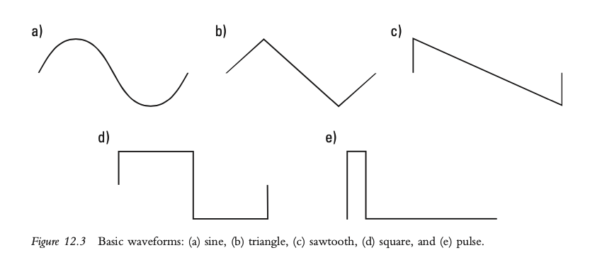
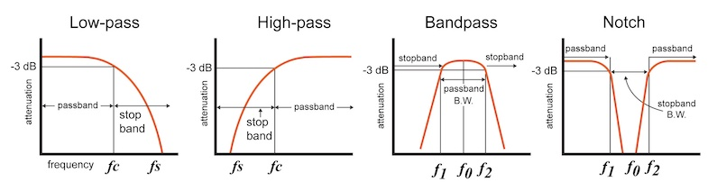
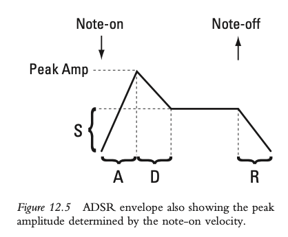
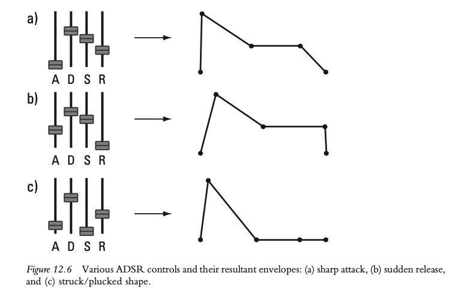

+++
title = "Electronic Sound Production"
outputs = ["Reveal"]
[reveal_hugo]
# show_notes = "separate-page"
+++

# Electronic sound production

Synthesis: building and shaping a sound

{}
Instructor preparation

- Have Vital installed and a REAPER instrument track receiving MIDI. Use one oscillator, no effects, and a comfortable monitoring level.
- Prepare a pluck and a pad from the same waveform, pitch, and filter setting. Change only the amplitude envelope. Match their perceived loudness as closely as practical.
- Open the linked Ableton exercises before class. If unavailable, demonstrate the same controls in Vital; students can predict and sketch on paper while a partner or instructor operates the synth.

Suggested pacing across the scheduled meetings

- October 28, 15 minutes: opening comparison, signal path, waveforms, and filter prediction. Stop after “Check: pitch or brightness?”
- October 30, 50 minutes: retrieval and setup, 5; amplifier and envelopes, 10; guided Vital pluck-to-pad task, 15; one modulation demonstration and exit check, 5; modeled Roulette round and two student rounds with discussion, 15.
- History and synthesis-method slides follow the exit check as optional reference. Use a short excerpt in a later lesson or if time permits. Do not play every video in the core lesson.
- November 2: extend the saved patches with the fuller Vital introduction as time permits after the ear-training drill and beatmaking presentations. The initial two patches are practice, not a new graded submission.
{}

---

## Same source, different articulation

Listen to a pluck and a pad on the same note.

- What changes at the beginning and end?
- Which control might explain the difference?

{}
Play the prepared pair without showing the controls. Ask everyone to write a prediction, then compare with a partner. Accept everyday descriptions such as “fades in” or “stops slowly.” Reveal that only the amplitude envelope changed. Return to this pair during the patch task.

Connect to sampling: last week MIDI triggered recorded audio. Here MIDI triggers a synthesizer that generates and shapes its sound.
{}

---

## What you will be able to do

- Identify the oscillator, filter, and amplifier by their jobs.
- Predict a change in brightness or articulation.
- Save a pluck and a pad, then explain two choices.

{}
Use these as the success criteria for the exit check. Students do not need to memorize historical names or every synthesis method today. These patches can become starting points for Project 5, which will ask for original patches used in a composition.
{}

---

## The audio path

Oscillator → Filter → Amplifier → Output

- Oscillator: generates the raw sound.
- Filter: shapes its frequency content.
- Amplifier: controls its level.

{}
Trace one held note through the path. This is a useful starting model for subtractive synthesis, not the architecture of every synthesizer.

Keep the control path distinct: an envelope sends changing control values to amplifier gain. Audio does not travel through the envelope generator. An envelope can also control filter cutoff or other destinations.

In Vital, point to Oscillator 1, Filter 1, and Envelope 1. The amplitude control is part of the instrument's routing; students do not need to locate a separate hardware-style VCA panel. Confirm that Oscillator 1 is actually routed through the enabled filter before demonstrating cutoff.
{}

---

## Oscillators: pitch and waveform

Frequency sets the repetition rate and pitch.
Waveform changes the harmonic content and timbre.

[Explore oscillators](https://learningsynths.ableton.com/en/oscillators/how-synths-make-sound)

{}
Hold pitch constant while changing waveform. Then keep the waveform and change pitch. Ask students to describe which dimension changed each time. Avoid adding unison, detune, and effects yet, so the comparison has one cause.
{}

---

## Basic waveforms

Predict, then listen: which sounds smoother, sine or saw?

{}
Use the same note at comparable loudness. Let students predict privately before hearing the pair, then explain their answer.

Sine contains only the fundamental. Ideal triangle and square waves contain odd harmonics; triangle's upper harmonics fall off faster. An ideal saw contains all integer harmonics. Real digital implementations limit their bandwidth. Teach the audible comparison first; the harmonic formulas are optional enrichment.
{}

---

## Filters: changing brightness

A low-pass filter attenuates high frequencies.

[Explore filters](https://learningsynths.ableton.com/en/filters/filters-in-the-real-world)

Hold a saw note. Predict what lowering cutoff will do, then try it.

{}
Connect to earlier EQ work. Keep pitch, waveform, envelope, and effects unchanged. Lower cutoff, listen, then restore it. Ask for “darker” or “less bright,” and ask whether the played MIDI note changed. Filtering can also change level, so avoid equating brighter with louder.

Cutoff sets the transition region. Resonance emphasizes frequencies near cutoff. Demonstrate resonance only after students recognize cutoff. Filter slope, drive, and key tracking can wait for later patch work.
{}

---

## Filter responses

Which response would reduce a saw's high-frequency buzz?

{}
Have students point to the response and explain what happens to the highs. Low-pass is the target. Briefly distinguish high-pass, band-pass, and notch using the image. Leave them as reference rather than adding four independent demonstrations today.
{}

---

## Check: pitch or brightness?

A held note becomes darker; its MIDI note stays the same.

Which is the likely change?

- Oscillator tuning
- Low-pass cutoff

Explain what you expect to hear if tuning changes instead.

{}
Give everyone 20 seconds to choose and explain before taking responses. Target: lower low-pass cutoff changes the spectrum; tuning changes the oscillator's repetition rate and pitch. Demonstrate both if answers suggest confusion. End Wednesday here and begin Friday by recalling the audio path without looking.
{}

---

## Amplifier and envelope

The amplifier changes audio level.
The envelope controls how that level changes over time.

MIDI note-on starts the envelope.
Note-off starts its release.

{}
Return to the opening pluck and pad. Show Envelope 1 in Vital and identify its control of amplitude. The envelope is a control signal, not an audio source. Change only attack while holding pitch, waveform, and filter constant.

This describes the normal gated ADSR behavior used in today's task. Synthesizers can offer other trigger and looping modes.
{}

---

## ADSR: time and level

Attack, decay, release: time. Sustain: level.

{}
Attack is time to peak. Decay is time from peak to sustain. Sustain is the level held after decay while the key remains down. Release is the fade after note-off.

Trace the key-down interval explicitly. Ask whether raising sustain means holding the key longer; it does not. In the figure, peak level is shown as velocity-dependent. Velocity only affects level when the instrument maps it that way; that behavior is not universal.

Optional interactive support: https://learningsynths.ableton.com/en/envelopes/change-over-time
{}

---

## Predict the articulation

Which shape keeps fading while you hold the key? Why?

{}
Target: the plucked shape, c, decays toward zero sustain even while the key stays down. Demonstrate with a long held note. Contrast with a sustained pad.

Then ask which parameter changes the tail after key-up. Target: release. Have students sketch a pad envelope before they touch the synth.
{}

---

## Guided Vital patch: pluck

1. Initialize a patch. Use one saw oscillator, no effects.
2. Enable a low-pass filter and route Oscillator 1 through it.
3. Use fast attack, short decay, low sustain, short release.
4. Save as `YourName_Pluck_v1`.

{}
Allow about 7 minutes of the 15-minute patch task. Demonstrate each step and let students follow. First verify MIDI input and sound, then filter routing. Keep the patch simple; wavetable morphing and unison come later.

Approximate starting values: attack 5 ms, decay 250 ms, sustain 0%, release 100 ms. These are starting points, not assessed targets. Hold a note to check that it fades while the key stays down. Listen for clicks and soften the attack if necessary. Keep output at a comfortable level.

If setup fails, use the Ableton Synth Playground or work with a partner. Record the settings or a sketch so the student can rebuild the patch in Vital later. A Playground sketch does not replace a saved Vital preset for Project 5.
{}

---

## Your turn: pluck to pad

Keep the oscillator and filter unchanged.

- Lengthen attack and release; raise sustain.
- Hold a note, then release it. Compare with the pluck.
- Save as `YourName_Pad_v1` and explain two changes to a partner.

{}
Allow about 8 minutes. Students predict the change before adjusting controls. Offer attack 400 ms, sustain 70%, release 800 ms as optional starting values; decay can remain unchanged.

Check that both patches exist and that students can explain “slower entry” and “longer tail” with reference to attack and release. Differentiate the sustained sound from a long release after note-off. Invite students to switch between presets while the partner listens without seeing the screen.

Both are practice patches that can be developed for Project 5. No additional graded submission is required.
{}

---

## Modulation: source and destination

A source changes a destination parameter.

Envelope → amplifier gain: note articulation.
LFO → filter cutoff: repeating brightness change.

[Explore repeating change](https://learningsynths.ableton.com/en/lfos/change-that-repeats)

{}
Keep this to one instructor demonstration today. An LFO is a low-frequency oscillator used here as a control source. Route it to cutoff, start with a modest amount, and change only its rate. Ask students to predict whether the motion will speed up or become deeper. Rate changes speed; modulation amount changes depth.

Contrast a triggered envelope with this repeating LFO example. More routing practice comes in the modulation lesson. A moving sound could also come from effects or another source, so listening gives a hypothesis to test, not proof of the patch's wiring.
{}

---

## Exit check

Play your pluck and pad for a partner.

- Trace the audio path and explain two envelope choices.
- Predict a cutoff change, then test it.
- Confirm that both presets are saved.

{}
Ask each student for a brief written explanation or check it verbally while circulating. Success means identifying the three audio stages, connecting settings to audible differences, and making a prediction that can be tested. If time is short, collect the explanation and revisit unresolved questions next class.

Use a modeled round of Vital Roulette next: describe what is audible, predict a cause, change or bypass one relevant control, then compare. The fuller Vital introduction extends today's saved patches with waveform choices, unison, and morphing.

The core lesson ends here. The remaining slides are optional history and reference.
{}

---

# Optional history and reference

Different instruments offer different ways to shape sound.

{}
Choose one example and connect it to the audio and control paths already learned. These slides are available for review and later lessons. They are not a second required lecture before students can try their patches.
{}

---

## Wendy Carlos and the Moog

<iframe width="560" height="315" src="https://www.youtube.com/embed/4SBDH5uhs4Q" title="Wendy Carlos demonstrates the Moog synthesizer" frameborder="0" allow="accelerometer; autoplay; clipboard-write; encrypted-media; gyroscope; picture-in-picture" allowfullscreen></iframe>

Listen for a change in source, brightness, or articulation.

{}
Preview and select a brief excerpt before class. Pause after one audible transformation. Ask students to name the changed dimension and suggest a module that could cause it.

Historical context: Moog's modular instruments used separate modules and voltage control. Patch cables could carry audio or control signals. Wendy Carlos's work offers an example of synthesis used for musical interpretation and performance.
{}

---

## Buchla: shaping the source

<iframe width="560" height="315" src="https://www.youtube.com/embed/Y7nxZdkqWpk" title="Buchla 200e synthesizer demonstration" frameborder="0" allow="accelerometer; autoplay; clipboard-write; encrypted-media; gyroscope; picture-in-picture" allowfullscreen></iframe>

What changes in the tone while a sound continues?

{}
Choose a short, previewed excerpt. A useful broad comparison is Moog-associated subtractive filtering and Buchla-associated timbre shaping and modulation. These are tendencies, not exclusive rules or a complete account of either designer.

The 200e is a later instrument, not a recording of a 1960s system. Ask for an audible observation before introducing terms such as wavefolding or complex oscillator. Students do not need to reproduce this patch today.
{}

---

## Yamaha DX7: another approach

<iframe width="560" height="315" src="https://www.youtube.com/embed/Q1Ha0MMT0aA?start=165" title="Yamaha DX7 electric piano and synthesis demonstration" frameborder="0" allow="accelerometer; autoplay; clipboard-write; encrypted-media; gyroscope; picture-in-picture" allowfullscreen></iframe>

Describe the attack and how brightness changes afterward.

{}
Use a brief electric-piano example. The DX7, released in 1983, helped popularize digital FM synthesis. Avoid claiming that every synthesizer follows the subtractive audio path.

For enrichment: operators combine oscillators and envelopes. Carrier outputs contribute to the audible result; modulators change other operators. The detailed FM mechanism and algorithms are beyond today's outcomes.

Historical source: https://usa.yamaha.com/products/contents/music_production/synth_50th/history/chapter002.html
{}

---

## Building a trumpet-like tone

- Listen to a recorded note's attack and sustained tone.
- Inspect its harmonics and their relative levels.
- Combine sine oscillators, then shape their levels over time.

{}
Optional additive-synthesis case study. Use a recording and spectrum or spectrogram in Sonic Visualizer. Start with harmonic ratios 1f, 2f, 3f, and so on, using levels observed in the recording. There is no fixed 1/n amplitude recipe for a trumpet.

A static harmonic balance alone will not reproduce the changing attack and spectrum. Compare the initial construction with a version whose partial levels change over time. Ask what remains different from the recording. The purpose is to show another method, not to promise acoustic realism from a few oscillators.
{}

---

## Synthesis methods: reference

- Subtractive: filter a harmonically rich source.
- Additive: combine simpler components.
- FM: use oscillators to modulate other oscillators.
- Wavetable: select or scan waveform frames.

{}
These are methods, not mutually exclusive instrument categories. Vital uses wavetables and also offers filtering and modulation. The patch task used a simple waveform and subtractive shaping within that instrument.

Other methods include granular synthesis, which works with short grains of audio, physical modeling, which simulates aspects of vibrating systems, and sample-based approaches. Offer these as directions for later exploration rather than vocabulary to memorize now.
{}

---

## Further exploration

[Open the Synth Playground](https://learningsynths.ableton.com/en/playground)

Choose one sound to change. Predict, adjust one control, and explain what you hear.

{}
Optional extension: add noise for a percussive attack, or compare two waveforms under the same envelope. Noise is a useful sound source without a stable repeating cycle. Keep effects off initially so the cause of the change is audible.

For the next guided practice, return to the saved pluck and pad in Vital. Develop them with the Vital introduction, then use them as starting points for original work in Project 5.
{}
